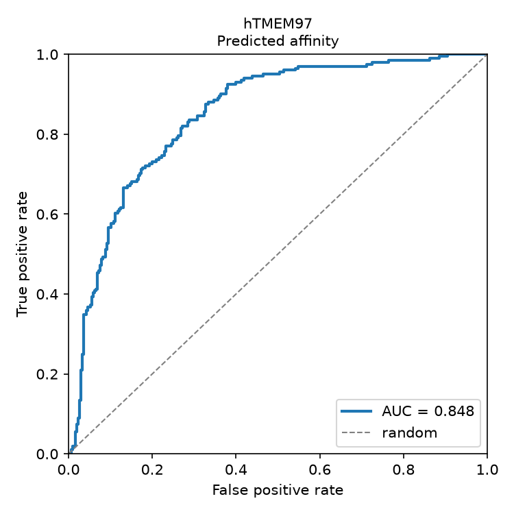

# Sigma-2 benchmark

Checking that the pipeline can run end-to-end on a large number of jobs, and produces sensible numbers.
This is a run using a published dataset just to see whether I can reproduce the same results.

## Plan

Kim et al., *Large-scale prospective evaluation of co-folding across hundreds of
Mac1-ligand complexes and three virtual screens*, eLife RP110475 (2026)
([article](https://elifesciences.org/articles/110475)) compares AlphaFold3, Chai-1
and Boltz-2 against DOCK3.7 on three virtual screens. Their dataset for the sigma-2 receptor consists of 506 compounds tested experimentally (201 actives and 305 inactives). Their supplementary info provided compound SMILES, annotations, and their measured/predicted values so I'm just putting the exact same list through this pipeline.

NB: This run used the full length sequence for human TMEM97 (UniProt Q5BJF2); the published data used affinities measured on the human protein but all sigma-2 structures in the PDB (which are also in Boltz' training set) are bovine protein (78% similarity).

## The run

All 506 ligands ran fine on the cluster and took 3 h 42 m end to end, of which about 2h was structure prediction and 1.5h was the affinity stage.


## Results

Ranking the 506 compounds by Boltz's predicted affinity (`AFFINITY_PRED_VALUE`,
log10 IC50 in uM):

| Boltz-2 affinity | ROC AUC |
| --- | --- |
| This run | 0.848 |
| Boltz-2, as published | 0.838 |

The slight difference doesn't matter (various differences in seeds, likely in Boltz parameters, etc) - but a successful check that my pipeline runs correctly.

Analysis:
```
python Scripts/calculate_enrichment.py --experiment 001_eLife_Sigma2_test
```



